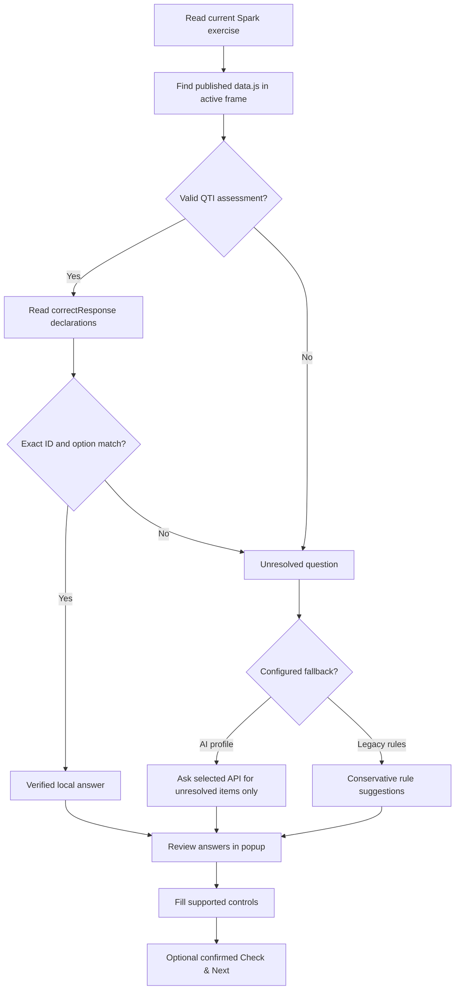

<div align="center">
  

  # Spark Study Assistant

  **Answers from the exercise first. AI only when needed.**

  A local-first Chrome extension for reviewing and filling supported exercises on National Geographic Learning Spark.

  [](#installation)
  [](CHANGELOG.md)
  [](#project-structure)
  [](#testing)

  [**Get started**](#installation) · [**How answers are found**](#answer-pipeline) · [**Project structure**](#project-structure) · [**Tiếng Việt**](README.vi.md)
</div>

---

<div align="center">
<table>
  <tr>
    <td align="center"></td>
    <td align="center"></td>
  </tr>
  <tr><td align="center"><sub>Light · compact question review</sub></td><td align="center"><sub>Dark · Liquid Glass surfaces</sub></td></tr>
</table>
</div>

> [!NOTE]
> UI screenshots are **illustrative** (mock exercise data). The QTI reader has been tested with simulated five-choice and six-text-entry browser fixtures, but not every Spark interaction type or authenticated assignment has been verified.

## What's new in 0.7.0 — QTI adapters

The QTI-first reader now handles **single-choice radios, multiple-choice checkboxes, shuffled option IDs, text-entry variants and multiple assessment screens**, in addition to existing dropdowns and text blanks. The source of truth is still the published `correctResponse` declaration, validated against the current screen and its controls.

The update was informed by 13 read-only exercise structure captures. The collection itself is **not included in the repository**. Radio and checkbox scanning/clicking were verified in an isolated Chromium fixture; authenticated Spark sessions still need hands-on validation.

**Review-only drag/drop:** `gapMatchInteraction` pairs can now be read and shown as suggested mappings, but automated dragging is disabled until live UI behavior is established. **Speaking and all Writing tasks (including Writing skill)** are explicitly deferred and do not receive the new adapter.

**Wordbuilding and text variants:** QTI may encode `play the piano|the piano` as alternatives, or return a partial-word suffix such as `tay`. The reader chooses a compatible value *for the blank*, never enters the literal `|`-joined string, and does not expand suffixes into full words. Multi-screen activities choose XML by question context and abstain on ambiguous matches.

[**Adapter compatibility & safety**](docs/QTI_ADAPTERS.md) · [**QTI reader internals**](docs/QTI_READER.md) · [**Changelog**](CHANGELOG.md)

## Previous releases

- **0.6.1** — Shared Wordbuilding banks, stricter QTI text validation, and diagnostic tooling.
- **0.6.0** — Initial QTI-first reading and reduced UI compositing cost.
- **0.5.x** — Glass appearance, adaptable color studio and popup size fix.

## Answer pipeline



The QTI reader is **not** a general answer-key scraper. See [implementation notes](docs/QTI_READER.md). It accepts an answer only when the client-side assessment has an explicit `responseDeclaration / correctResponse` and the `responseIdentifier` plus **entire choice set** match the visible exercise. The adapter supports dropdown, radio, checkbox and explicit text-entry declarations. Matching pairs can be displayed for review only. Reordering, automated drag/drop, deferred Speaking/Writing and custom controls remain unsupported or unchanged.

No downloaded script is evaluated by the QTI parser. The extension parses the JSON-escaped XML strings in `data.js`, with origin, size and structural checks. QTI content stays in the browser. **Only questions not matched locally are sent to your chosen AI provider.**

| Case | What happens |
|---|---|
| All visible choices map to QTI | **No AI call**; results marked `Verified QTI` |
| Some choices map | QTI answers are retained; only unmatched items use the configured fallback |
| Missing or malformed QTI | Existing single-AI, multi-AI comparison or legacy rules are used |
| Controls cannot be verified on-page | The extension does not silently submit |

## Features

| | Capability |
|---|---|
| ◈ | **QTI-first adapters** for dropdowns, radio, checkbox and text answers; view-only gap pairs |
| ↗ | **AI fallback** with independent OpenAI-compatible profiles and model comparison |
| ✓ | **Review & edit** each response before filling |
| ⌁ | **Guarded filling** for supported dropdown and text controls |
| ⇥ | **Check & next (experimental)** only after a user confirmation and DOM validation |
| ◐ | **Glass appearance**, Light / Dark / System and a nine-preset color studio with HEX & hue wheel |
| 文 | **Four languages**: English (default), Tiếng Việt, 简体中文, 繁體中文 |

## Installation

1. Download this repository or use **Code → Download ZIP** on GitHub.
2. Open **`chrome://extensions/`** in Chrome or Chromium.
3. Enable **Developer mode**, select **Load unpacked**, and choose the directory containing `manifest.json`.
4. Open an assignment on [NGL Spark](https://learn.eltngl.com/) and refresh the page once after installing/updating the extension.
5. Open Spark Study Assistant and follow **Scan → Solve → Review → Fill**. Use **Solve & fill** to run the workflow in one action, then inspect your answers on Spark.

No `npm install`, bundler or API key is needed to inspect *compatible* published QTI answers. **An API key and endpoint are required for an AI fallback** if an exercise is not fully covered by QTI or the limited legacy rules.

### Configure AI fallback

Go to **Settings → AI connections**, add profiles and choose the model(s) to use. Under **Answers**, select **Single AI**, **Compare AIs** or **Legacy rules**. The chosen mode applies **only after** QTI checking; a successful QTI answer never needs an API call.

OpenAI-compatible Chat Completions endpoints are supported (OpenAI, OpenRouter, Groq, DeepSeek, compatible Gemini endpoints, Ollama local server, custom endpoint). Native Anthropic Messages and the OpenAI Responses API are *not* directly implemented.

### Personalize the interface

<div align="center">
<table>
<tr><td></td><td></td></tr>
</table>
</div>

Select Light, Dark or System, pick one of nine colors, enter a custom HEX value or use the hue ring and intensity slider. Preferences stay in `chrome.storage.local`. For smoother scrolling, glass blur is concentrated in larger surfaces rather than every nested row; reduced-motion and reduced-transparency preferences are respected.

## Project structure

```text
spark-study-assistant/
│
├── manifest.json                 # Chrome MV3 permissions, scripts & version
├── popup.html                    # Popup shell and actions
├── popup.js                      # Scan → QTI → fallback → review → fill
├── options.html                  # Settings layout
├── options.js                    # AI profile, language and preference editing
├── styles.css                    # Layout, glass tokens, responsive/accessibility
├── appearance.js                 # Light/dark/wallpaper runtime
├── color-studio.js               # Swatches, hue wheel and HEX validation
├── i18n.js                       # UI copy for four languages
│
├── content.js                    # Per-iframe DOM scan, fill and check/next
├── qti.js                        # Safe QTI XML parsing, multi-screen & ID adapters
├── background.js                 # Orchestrates fallback API requests
├── providers.js                  # Provider profiles, schemas and comparison
├── solver.js                     # Small legacy ruleset (not a local LLM)
│
├── _locales/                     # Chrome manifest translations
│   ├── en/  ├── vi/  ├── zh_CN/  └── zh_TW/
├── icons/                        # Bundled extension icons
├── docs/
│   ├── screenshots/              # UI previews (illustrative)
│   ├── AUTOMATION_DISCOVERY.md   # Privacy-safe DOM investigation
│   ├── QTI_READER.md            # Reader design, validation and limits
│   ├── QTI_ADAPTERS.md          # Radio, checkbox, text, multi-screen, pair previews
│   ├── WORD_BUILDING.md          # Shared bank + text-gap compatibility
│   ├── GLASS_DESIGN.md           # Visual/material decisions
│   └── ...                       # Historical design/research notes
├── tools/
│   └── inspect-wordbuilding.js  # Read-only DOM/QTI discovery console script
└── tests/                        # Zero-dependency Node regression tests
    ├── qti.test.js               # XML answers, mismatches and fallback
    ├── qti-adapters.test.js      # New interaction and multi-screen regression cases
    ├── browser-adapters.html     # Isolated Chromium smoke-test fixture
    ├── wordbuilding.test.js      # Collocation guards and bank handoff
    ├── providers.test.js
    ├── solver.test.js
    ├── background.test.js
    ├── appearance.test.js
    ├── i18n.test.js
    └── ui.test.js
```

## Testing

Run the regression suite from PowerShell (single paste):

```powershell
& {
    Set-Location "$HOME\Downloads\spark-study-assistant"
    node --test
}
```

The **106 automated Node tests** cover existing functionality and new radio, checkbox, alternatives, suffix-only answers, ambiguous multi-screen XML selection and gap-pair previews. An isolated Chromium test also verified DOM scanning and clicking one radio plus two checkboxes. These are synthetic tests, **not** an authenticated Spark compatibility guarantee.

## Permissions & safety

- Reads exercise content in authorized Spark frames; cross-origin scripts are *not* fetched by the QTI reader.
- API requests carry only unresolved extracted question/choice data to the selected provider — not LMS cookies, tokens or assignment URL.
- API keys remain in Chrome local extension storage, which is **not a hardened secrets vault**; never add credentials to Git.
- **Check & next** requires an explicit user click and confirmation. It may not be equivalent to the final LMS score submission. See [automation evidence](docs/AUTOMATION_DISCOVERY.md).
- No background telemetry, remote UI framework, embedded LLM or large offline knowledge database.

---

<div align="center">
  <strong>Less guessing. More verifiable answers.</strong><br />
  <sub>Independent open-source companion; not affiliated with National Geographic Learning, Spark or Avallain.</sub><br /><br />
  <a href="README.vi.md">Đọc bản tiếng Việt</a> · <a href="CHANGELOG.md">Changelog</a> · <a href="docs/AUTOMATION_DISCOVERY.md">Known limitations</a>
</div>
