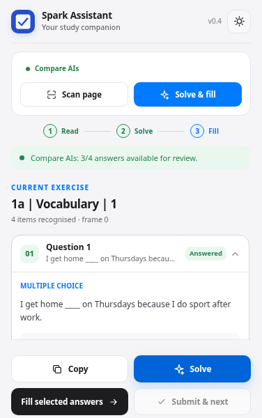
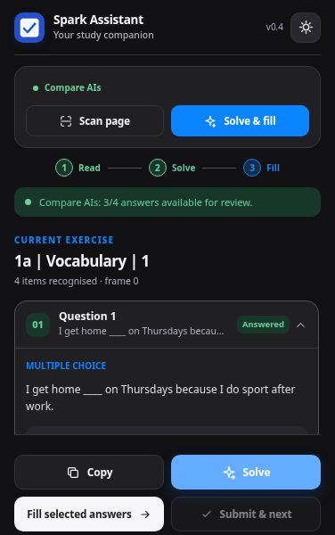

<div align="center">


# Spark Study Assistant

**A quieter way to work through NGL Spark exercises.**

Read the current exercise · Compare AI answers · Review · Fill · Check

[**English**](README.md) · [**Tiếng Việt**](README.vi.md) · [**Design notes**](docs/UI_DESIGN.md) · [**Changelog**](CHANGELOG.md)


</div>

---

## A small space for focused work

Spark Study Assistant is a **locally installed Chrome extension** for selected exercise formats on [National Geographic Learning Spark](https://learn.eltngl.com/). It reads exercise elements inside supported frames, optionally asks an API-compatible AI model for answers, then lets you inspect and apply those answers.

The interface borrows the **calm, practical language of iOS and macOS**: compact controls, deliberate hierarchy, subdued surfaces and an explicit review step. The redesign was audited against the [Hallmark](https://github.com/nutlope/hallmark) design skill, with product behavior preserved in vanilla HTML/CSS/JavaScript.

<table align="center">
<tr><td align="center"></td><td align="center"></td></tr>
<tr><td align="center"><small>Light mode</small></td><td align="center"><small>Dark mode</small></td></tr>
</table>

> [!NOTE]
> Screenshots use **mock exercise data**. They are not captured from a live student's account, and integration with every NGL Spark exercise format has not been verified.

## What it does

| Capability | Behavior |
|---|---|
| **Exercise recognition** | Scans authorized Spark iframe documents; detects dropdowns, input fields and some static formats. |
| **Multiple AI services** | Configurable OpenAI-compatible Chat Completions endpoints for OpenAI, OpenRouter, Groq, DeepSeek, Gemini, Ollama local API and custom services. |
| **Model comparison** | Compare configured providers; disagreements remain choices for you to review. |
| **Editable answer review** | Expand questions, choose dropdown answers and edit suggested responses. |
| **Controlled filling** | Attempts to fill supported controls and reports confirmed, uncertain, skipped or manual items. |
| **Check & next — experimental** | Explicit confirmation required. Only proceeds when all recognized items are verified and the page exposes suitable controls. |
| **Interface languages** | English (default), Tiếng Việt, 简体中文, 繁體中文. |
| **Appearance** | Light, Dark or Follow system — persisted locally and shared between popup and Settings. |
| **Legacy offline rules** | Kept for compatibility; not being expanded in this release. API-backed solving is the recommended path. |

### Install from source

1. Download or clone this repository.
2. Open `chrome://extensions/` in Chromium/Chrome.
3. Enable **Developer mode** and choose **Load unpacked**.
4. Select the folder containing `manifest.json`.
5. Open an exercise on `learn.eltngl.com`; refresh any Spark tab that was open before installation.
6. Open the extension: **Scan page → Solve → Review → Fill**. Or use **Solve & fill** when you are confident the format is supported.

No `npm install`, build step or backend service is required for the UI and rule engine. **AI requests require a provider key/endpoint and potentially incur charges.** A ChatGPT subscription does not provide OpenAI API credits.

### Language and appearance

Open **Settings → General**. Select a display language and a theme, then press **Save changes**. English is the default for new installations, regardless of your browser language. Your selection is saved in `chrome.storage.local` and applies to the popup and Settings.

### Configure an AI provider

Open **Settings → AI connections** to add a profile, edit its model ID, endpoint and key, and decide whether it participates in comparisons. In **Answers**, select **Single AI**, **Compare AIs**, or **Legacy rules**. Press **Save changes** and approve the host permission for the endpoint if Chrome asks.

Only **OpenAI-compatible Chat Completions** is supported (`POST …/chat/completions`). Native Anthropic Messages / OpenAI Responses payloads are not implemented. Some models require **Prompt only** rather than a JSON response format. Ollama runs as a separate local service; it is not an embedded LLM.

## Check answers and move forward — experimental

The popup now includes **Submit & next**. This is an **explicit, confirmed** action; it does not run as part of **Solve & fill**.

1. Review the proposed answers and choose **Fill selected answers**.
2. The button is enabled **only if every recognized exercise item was filled and positively verified**. Unsupported, skipped or uncertain items block automation.
3. Confirm the action. The extension attempts to click the known Spark **Check Answers** control (`[data-event="check"]`).
4. It watches for a changed check state / answer status. Only if it can confirm this and **Move to next exercise** is enabled in Settings will it attempt the explicit next-learning-object control (`[data-event="forward_lo"]`).
5. If the site does not confirm the step, or the next control is missing, the extension **stops** rather than clicking an unrelated element. Double submissions are also guarded within a scan session.

> [!WARNING]
> **`Check Answers` is not proven to be the final LMS score submission for all assignments.** The current HTML evidence shows separate `Check Answers`, `Results` and `Next` controls, but not every post-check state. This feature should be treated as an **opt-in beta**. It does **not** guarantee grading, score delivery or progression for every activity. See [DOM evidence needed](docs/AUTOMATION_DISCOVERY.md) for a privacy-safe way to help improve it.

## Compatibility boundaries

| Exercise type | Read / solve | Apply on-page |
|---|---|---|
| Dropdown (vocabulary, pronunciation with visible transcript) | Yes, when options are present | Attempt, then verify selected item |
| Text input (verb forms, short answers) | Yes | Attempt, then verify value |
| Static word ordering | Some detection / suggestions | **Manual**; no drag/drop automation |
| Find-and-correct text | Some detection / suggestions | **Manual**; no click-to-edit support |
| Audio without transcript | Not supported | Not supported |
| Unrecognized cross-origin frame | Requires host permission / selector review | Not guaranteed |

## Privacy, permissions and limitations

- **API data:** only extracted question and option fields are intentionally sent to your selected provider. No Spark cookie, authentication token or assignment URL is intentionally included in AI payloads.
- **Secrets:** API keys are stored in `chrome.storage.local`, restricted to trusted extension contexts on supporting Chrome versions. This is **not a cryptographic vault** against a compromised device; never commit personal keys to the repository.
- **Endpoint access:** HTTPS endpoints and local loopback services are validated; optional host permissions are requested when you save active profiles. Only choose endpoints you trust.
- **No auto-submit by default:** you must click **Submit & next** and confirm. The separate **Move to next exercise** preference controls automatic progression after a confirmed check.
- **No unsupported promises:** JavaScript-triggered click events may not reproduce every interaction of the learning platform. A live account/browser test is needed before relying on the new workflow.

## Project structure

```text
spark-study-assistant/
├── popup.html / popup.js        # Compact exercise workflow
├── options.html / options.js    # AI profiles, language, theme, workflow
├── i18n.js                      # English, Vietnamese, 简体中文, 繁體中文
├── styles.css                   # Shared design tokens & responsive styling
├── content.js                   # Per-frame extraction, fill, check & next
├── background.js                # AI requests, safe provider fallback
├── providers.js / solver.js     # Profiles, model comparison, legacy rules
├── _locales/                    # Chrome extension metadata localization
├── docs/                        # Design and safe DOM evidence guides
└── tests/                       # Node built-in test runner
```

Run the tests:

```bash
node --test tests/*.test.js
```

There is no telemetry or additional remote UI runtime. The legacy offline research is archived in [`docs/OFFLINE_RESEARCH.md`](docs/OFFLINE_RESEARCH.md); no new offline packages or model weights were installed.

---

<div align="center">

**Built for reviewable answers, not silent clicks.**

[Tiếng Việt →](README.vi.md) · [UI design decisions](docs/UI_DESIGN.md) · [Automation limitations](docs/AUTOMATION_DISCOVERY.md)

<sub>Independent open-source helper. Not affiliated with or endorsed by National Geographic Learning or Spark.</sub>

</div>
