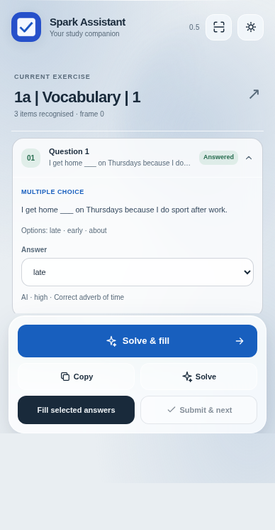
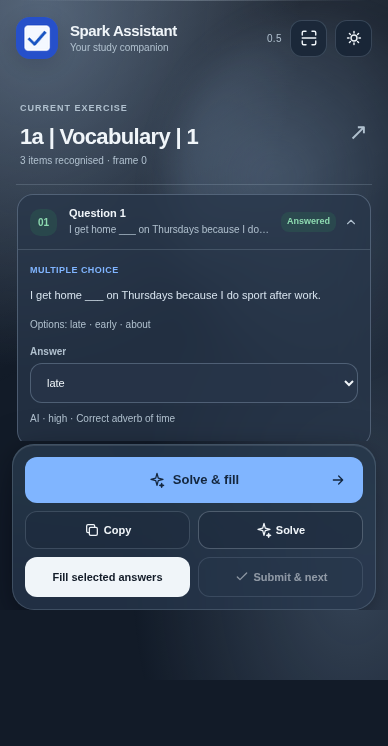
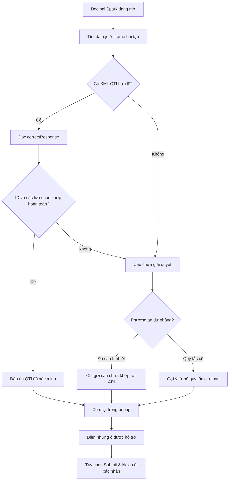
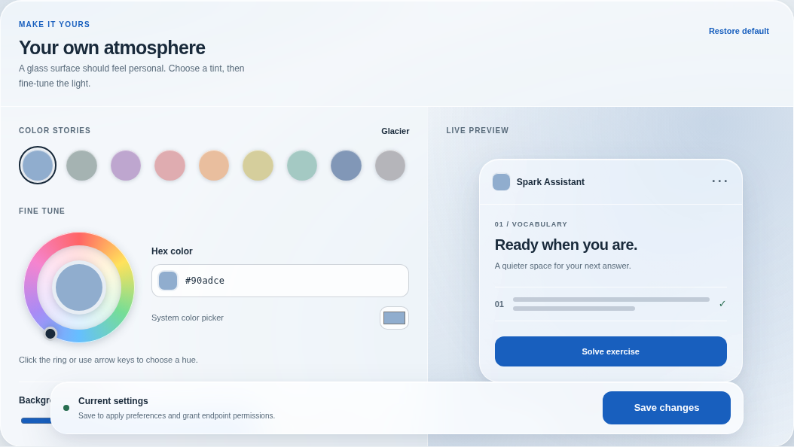
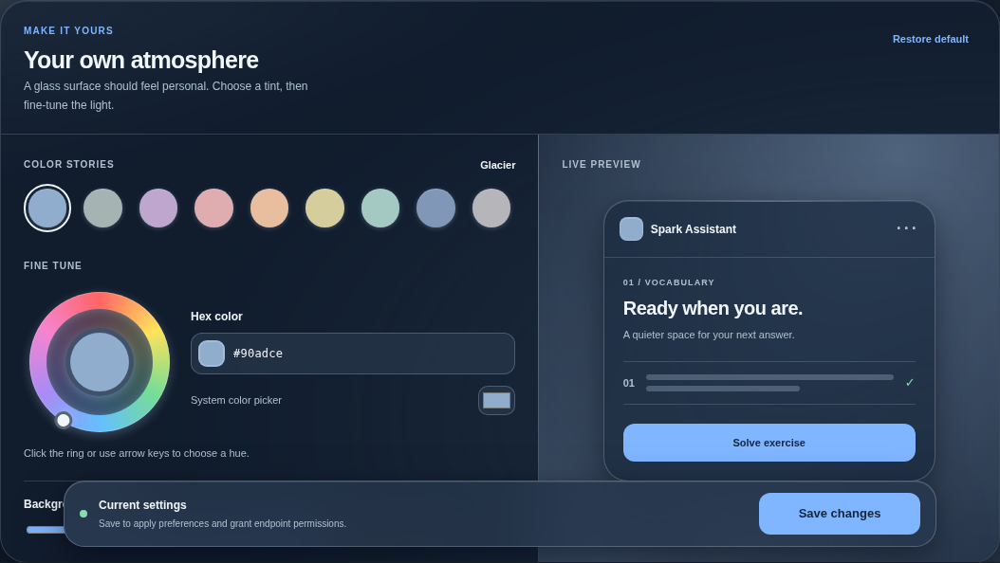

<div align="center">
  

  # Spark Study Assistant

  **Đọc đáp án từ bài tập trước. Chỉ dùng AI khi cần.**

  Tiện ích Chrome giúp đọc, xem lại và điền đáp án cho những dạng bài được hỗ trợ trên National Geographic Learning Spark.

  [](#cài-đặt)
  [](CHANGELOG.md)
  [](#cấu-trúc-dự-án)
  [](#kiểm-thử)

  [**Cài đặt**](#cài-đặt) · [**Cơ chế tìm đáp án**](#cơ-chế-tìm-đáp-án) · [**Cấu trúc**](#cấu-trúc-dự-án) · [**English**](README.md)
</div>

---

<div align="center">
<table>
<tr><td align="center"></td><td align="center"></td></tr>
<tr><td align="center"><sub>Chế độ sáng</sub></td><td align="center"><sub>Chế độ tối</sub></td></tr>
</table>
</div>

> [!NOTE]
> Các ảnh giao diện sử dụng **dữ liệu mô phỏng**. Bộ đọc QTI đã được kiểm thử trong Chromium với dữ liệu XML mô phỏng năm câu lựa chọn và sáu ô nhập văn bản; chưa thể khẳng định mọi dạng bài hoặc mọi tài khoản Spark đều tương thích.

## v0.7.3 — Review nhiều màn và xem đáp án sắp xếp từ

Dựa trên **8 bản quét Spark thực tế bổ sung**, extension nhận diện dạng `orderInteraction` trong bài **Review Real life**. Khi các thẻ từ/dấu câu trên màn đang mở khớp chính xác với **một XML QTI duy nhất**, extension hiển thị câu theo thứ tự đúng. **Chưa tự kéo-thả**, vì chưa kiểm chứng được thao tác cập nhật trạng thái của Avallain. Solve & fill chỉ đưa ra đáp án để xem rồi bạn tự sắp xếp trên Spark; không tự nộp dạng này.

Với bài **Review gồm 10 màn** có radio, bộ chọn XML giờ đối chiếu cả **chữ của phương án** và ID ổn định, tránh nhầm những màn đều dùng `C0_0`, `RESPONSE0`. Những câu khớp chắc chắn tiếp tục được tự chọn bằng adapter radio hiện có; trường hợp mơ hồ sẽ không đoán.

**Speaking và toàn bộ Writing (kể cả Writing skill) vẫn được giữ nguyên.** Cơ chế nộp v0.7.2 không đổi. Đã kiểm thử **123/123 bài Node** và tương tác Chromium mô phỏng (5/5 radio, chọn đúng QTI theo màn sắp xếp); chưa xác nhận trên phiên Spark đăng nhập.

## v0.7.2 — Sửa Submit & next theo kết quả chẩn đoán thực

Báo cáo từ bài **1b | Grammar | 3** xác nhận Spark dùng nút **Submit to Gradebook** (`data-event="submit"`) để nộp bài, không phải nút **Check Answers** đang bị ẩn. Sau khi người dùng tự nhấn nộp, nút chuyển sang trạng thái không hoạt động sau khoảng 1,2 giây; nút **Next** (`forward_lo`) vẫn khả dụng.

Extension hiện ưu tiên nút nộp của Spark, chỉ dự phòng Check Answers khi nút đó thực sự khả dụng. Trước khi nộp vẫn yêu cầu xác nhận, kiểm tra mọi câu đã điền và đối chiếu lại DOM. Chỉ yêu cầu chuyển bài khi thấy nút nộp đổi trạng thái và có **đúng một** nút Next đang hoạt động; tình huống mơ hồ thì dừng, không tự nộp lại. Có thể tắt tự chuyển bài trong Settings. **Nút bị vô hiệu hóa không chứng minh máy chủ đã lưu điểm.** Mới có một bài được chẩn đoán thực tế; các nhánh khác được kiểm thử bằng Chromium mô phỏng.

## Bản v0.7.1 — Tối giản thao tác và sao chép đầy đủ đề bài

Popup chỉ còn **Solve & fill**, **Sao chép đề** và nút **Submit & next** có kiểm tra an toàn. Hai nút Solve và Fill selected answers riêng đã được bỏ. Sao chép đọc trực tiếp **màn hình đang mở** trên Spark: hướng dẫn, câu hỏi đầy đủ, ngân hàng từ và lựa chọn; không xuất câu trả lời đã nhập, khóa QTI hoặc màn hình ẩn.

**Submit & next vẫn cần kiểm tra với bài Spark thật.** Luồng nộp/Next hiện dựa trên bản ghi thực từ một bài Grammar, không dựa trên suy đoán về nút Check Answers. Nếu không thấy xác nhận thay đổi giao diện, extension sẽ dừng và không tự nhấn Next.

## Có gì mới ở v0.7.0 — Mở rộng QTI Adapter

Bộ đọc QTI hiện hỗ trợ **radio (chọn một), checkbox (chọn nhiều), lựa chọn đảo thứ tự, nhiều cách viết đáp án văn bản và bài có nhiều màn hình**, ngoài dropdown và ô chữ đã có. Mỗi đáp án phải được xác minh bằng ID và cấu trúc QTI trên màn hiện tại.

Bản nâng cấp dựa trên **13 báo cáo quét cấu trúc thực**, nhưng dữ liệu bài tập gốc không được đưa vào repository. Bộ quét và thao tác radio/checkbox đã chạy qua thử nghiệm Chromium cô lập; vẫn cần kiểm tra trên Spark đã đăng nhập.

**Kéo-thả:** Bộ đọc có thể hiện các cặp từ/ô từ `gapMatchInteraction` để người dùng xem, nhưng **chưa tự kéo thả**. **Speaking và toàn bộ Writing (kể cả Writing skill)** được giữ nguyên và không bật adapter mới trong phiên bản này.

**Wordbuilding:** Đáp án `play the piano|the piano` được hiểu là các biến thể hợp lệ, **không điền nguyên chuỗi có dấu `|`**. Các ô chỉ thiếu phần cuối từ như `s___` vẫn được điền chính xác `tay`, không phải `stay`. Với XML nhiều màn trùng Response ID, bộ đọc so ngữ cảnh câu trước khi quyết định; nếu không phân biệt được sẽ không đoán.

[**Bảng tương thích & an toàn**](docs/QTI_ADAPTERS.md) · [**Kỹ thuật QTI**](docs/QTI_READER.md) · [**Changelog**](CHANGELOG.md)

## Các phiên bản trước

- **0.6.1** — Ngân hàng từ Wordbuilding và kiểm tra đáp án text nghiêm ngặt.
- **0.6.0** — Đọc QTI trước API và tối ưu độ mượt.
- **0.5.x** — Liquid Glass, Color Studio và sửa kích thước popup.

## Cơ chế tìm đáp án



Bộ đọc QTI **không** lấy đáp án bằng cách đoán tên trường (xem [tài liệu kỹ thuật](docs/QTI_READER.md)). Chỉ chấp nhận kết quả nếu XML có `responseDeclaration / correctResponse`, `responseIdentifier` hợp lệ và **toàn bộ danh sách lựa chọn** trùng với bài đang hiển thị. Hỗ trợ dropdown, radio, checkbox và ô nhập văn bản khi QTI khớp chắc chắn. Kéo-thả chỉ hiện cặp đáp án để xem, chưa tự thao tác; Speaking/Writing chưa mở rộng.

Bộ đọc **không chạy/eval mã `data.js`**: chỉ phân tích chuỗi XML đã mã hóa trong nội dung JavaScript, với giới hạn origin, kích thước và cấu trúc. Dữ liệu QTI xử lý trong trình duyệt; **chỉ câu chưa ánh xạ được mới gửi tới API AI đã chọn**.

| Tình huống | Cách xử lý |
|---|---|
| Tất cả ô đều khớp XML | **Không tốn lượt gọi API**; hiển thị `QTI đã xác minh` |
| Một phần ô khớp | Giữ đáp án QTI; chỉ gửi câu còn lại tới bộ giải dự phòng |
| Không có QTI hoặc QTI sai cấu trúc | Dùng Single AI, Compare AIs hoặc quy tắc cũ theo cài đặt |
| Không xác minh được thao tác điền | Dừng, không tự nộp ngầm |

## Các tính năng

| | Chức năng |
|---|---|
| ◈ | **QTI Adapter**, gồm dropdown, radio, checkbox, text; xem cặp kéo-thả |
| ↗ | **AI dự phòng**: nhiều hồ sơ API và so sánh mô hình |
| ✓ | **Xem và sửa đáp án** trước khi điền |
| ⌁ | **Điền có kiểm tra** với dropdown/ô nhập hỗ trợ |
| ⇥ | **Check & Next (thử nghiệm)**: chỉ thực hiện khi người dùng xác nhận |
| ◐ | **Liquid Glass**, sáng/tối/theo hệ thống, 9 màu, vòng màu và mã HEX |
| 文 | **4 ngôn ngữ**: English mặc định, Tiếng Việt, 简体中文, 繁體中文 |

## Cài đặt

1. Tải repository này hoặc chọn **Code → Download ZIP** trên GitHub.
2. Mở **`chrome://extensions/`** trên Chrome/Chromium.
3. Bật **Developer mode**, nhấn **Load unpacked**, chọn thư mục chứa `manifest.json`.
4. Mở bài tập tại [NGL Spark](https://learn.eltngl.com/) và **tải lại tab Spark** sau khi cài hoặc cập nhật tiện ích.
5. Mở extension, thao tác theo thứ tự **Quét → Giải → Xem lại → Điền**. Có thể chọn **Giải & điền** để chạy liên tiếp rồi kiểm tra kết quả trên Spark.

Không cần cài npm hoặc nhập khóa API để đọc đáp án QTI **khi dữ liệu bài tập tương thích**. Bạn cần khóa API/endpoint nếu muốn dùng AI cho các bài chưa có đáp án QTI hoặc ngoài phạm vi bộ quy tắc cũ.

### Cấu hình AI dự phòng

Vào **Settings → AI connections**, thêm hồ sơ API và chọn model. Tại mục **Answers**, chọn **Single AI**, **Compare AIs** hoặc **Legacy rules**. Lựa chọn này chỉ được dùng **sau bước QTI**; một câu đã xác minh bằng QTI sẽ không phải gọi API.

Hiện hỗ trợ endpoint theo giao thức OpenAI-compatible Chat Completions: OpenAI, OpenRouter, Groq, DeepSeek, Gemini tương thích, Ollama chạy bằng máy chủ local và endpoint tùy chỉnh. Chưa trực tiếp hỗ trợ Anthropic Messages hoặc OpenAI Responses API.

### Tùy chỉnh giao diện

<div align="center"><table><tr><td></td><td></td></tr></table></div>

Chọn **Sáng / Tối / Theo hệ thống**; dùng một trong chín màu có sẵn, nhập HEX, chọn qua vòng sắc độ và chỉnh cường độ nền. Các tùy chọn lưu trong `chrome.storage.local`. Hiệu ứng kính tập trung ở bề mặt chính để giảm tình trạng giật khi cuộn; những cài đặt hạn chế chuyển động hoặc độ trong suốt vẫn được tôn trọng.

## Cấu trúc dự án

```text
spark-study-assistant/
│
├── manifest.json                 # Cấu hình Chrome MV3
├── popup.html                    # Giao diện tiện ích
├── popup.js                      # Quét → QTI → dự phòng → xem → điền
├── options.html                  # Bố cục cài đặt
├── options.js                    # Chọn API, ngôn ngữ, giao diện
├── styles.css                    # Typography, màu, Liquid Glass, responsive
├── appearance.js                 # Chế độ sáng/tối và nền
├── color-studio.js               # Bộ màu, vòng màu, HEX
├── i18n.js                       # Nội dung giao diện 4 ngôn ngữ
│
├── content.js                    # Quét DOM từng iframe, điền, chấm/chuyển
├── qti.js                        # Phân tích data.js/XML và ánh xạ đáp án
├── background.js                 # Gọi API khi cần
├── providers.js                  # Cấu hình provider, so sánh model
├── solver.js                     # Bộ quy tắc cũ (không phải LLM offline)
│
├── _locales/                     # Ngôn ngữ metadata tiện ích
│   ├── en/  ├── vi/  ├── zh_CN/  └── zh_TW/
├── icons/                        # Biểu tượng có sẵn
├── docs/
│   ├── screenshots/              # Ảnh giao diện minh họa
│   ├── AUTOMATION_DISCOVERY.md   # Hướng dẫn thu thập DOM an toàn
│   ├── QTI_ADAPTERS.md          # Tương thích QTI theo loại bài
│   ├── QTI_READER.md            # Kiến trúc, kiểm tra và giới hạn QTI
│   ├── WORD_BUILDING.md          # Ngân hàng từ và ô điền văn bản
│   ├── GLASS_DESIGN.md           # Quyết định về chất liệu/giao diện
│   └── ...                       # Tài liệu nghiên cứu trước đây
├── tools/
│   └── inspect-wordbuilding.js  # Lệnh Console chẩn đoán chỉ đọc
└── tests/                        # Kiểm thử Node không cần thư viện ngoài
    ├── qti-adapters.test.js      # Radio / checkbox / nhiều màn
    ├── browser-adapters.html     # Bài thử Chromium cô lập
    ├── qti.test.js               # XML, đáp án, lỗi ánh xạ, API dự phòng
    ├── wordbuilding.test.js      # Ngữ cảnh ngân hàng từ và ô điền
    ├── providers.test.js
    ├── solver.test.js
    ├── background.test.js
    ├── appearance.test.js
    ├── i18n.test.js
    └── ui.test.js
```

## Kiểm thử

Trên PowerShell, chạy một lần:

```powershell
& {
    Set-Location "$HOME\Downloads\spark-study-assistant"
    node --test
}
```

Bộ **109 bài kiểm thử Node** kiểm tra mapping QTI, radio, checkbox, phương án text thay thế, bài nhiều màn, ô chỉ điền phần còn thiếu, API dự phòng và giao diện. Bài thử Chromium riêng xác nhận quét/chọn radio, checkbox và **từ chối điền vào màn cũ** sau khi chuyển màn. Đây là các bài thử mô phỏng; **chưa thay thế thử nghiệm Spark đang đăng nhập.**

## Quyền truy cập và giới hạn

- Chỉ đọc nội dung bài trong những iframe Spark được cấp quyền; parser QTI không fetch script khác origin.
- Chỉ câu chưa ánh xạ mới được đưa vào payload API đã chọn; không cố ý gửi cookie, token hoặc URL assignment.
- API key lưu trong Chrome local storage, **không phải kho bí mật có mã hóa chuyên biệt**; tuyệt đối không đưa key vào Git.
- **Check & Next** phải do bạn nhấn và xác nhận. `Check Answers` chưa được chứng minh là nút gửi điểm cuối cùng trong mọi loại bài. Xem [hướng dẫn kiểm tra](docs/AUTOMATION_DISCOVERY.md).
- Không có telemetry, không tải framework UI từ Internet, không có LLM offline hay cơ sở dữ liệu kiến thức lớn.

---

<div align="center">
  <strong>Ít phỏng đoán hơn. Nhiều đáp án có thể kiểm chứng hơn.</strong><br />
  <sub>Dự án độc lập, không trực thuộc hoặc được National Geographic Learning, Spark hay Avallain chứng thực.</sub><br /><br />
  <a href="README.md">English README</a> · <a href="CHANGELOG.md">Changelog</a> · <a href="docs/AUTOMATION_DISCOVERY.md">Giới hạn tự động hóa</a>
</div>
